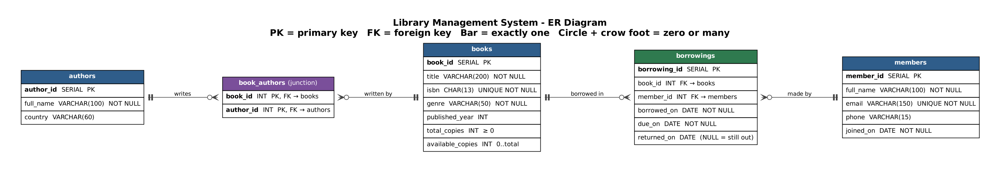

# Library Management System (PostgreSQL + Python)

A small library database (books, authors, members, borrowings) with SQL scripts
and a Python command-line app that runs the report queries.

This README walks you through everything in order:
**install → create database → run SQL files → run Python app → check in to Git → push to GitHub.**

---

## Where each assignment point is

| # | Assignment point | File(s) |
|---|------------------|---------|
| 1 | Design + relationships diagram | `docs/er_diagram.png` (source: `docs/er_diagram.dot`) |
| 2 | CREATE TABLE with keys and constraints | `sql/01_create_tables.sql` |
| 3 | Sample data (50 books, 10 genres, 5+ rows per table) | `sql/02_insert_data.sql` |
| 4 | The 4 queries (+ CRUD examples) | `sql/03_queries.sql` |
| 5 | "Borrow a book" transaction | `sql/04_borrow_transaction.sql` |
| 6 | Index + EXPLAIN ANALYZE proof | `sql/05_indexes_explain.sql` |
| 7 | Python app (modules, type hints, CLI, .env) | `main.py`, `library/` |
| 7a | DB details in a separate file | `.env` (your copy, not committed) and `.env.example` (committed) |
| 7e | Git repo with logical commits | Step 7 below |
| – | Dependencies | `requirements.txt` |

## Folder structure

```
library-management-system/
├── README.md
├── requirements.txt          # Python packages
├── .env                      # your DB password (ignored by Git)
├── .env.example              # template of .env (safe to commit)
├── .gitignore
├── main.py                   # entry point: python main.py
├── library/
│   ├── __init__.py
│   ├── models.py             # dataclasses for result rows
│   ├── storage.py            # DB connection + parameterized queries
│   └── cli.py                # text menu
├── sql/
│   ├── 01_create_tables.sql
│   ├── 02_insert_data.sql
│   ├── 03_queries.sql
│   ├── 04_borrow_transaction.sql
│   └── 05_indexes_explain.sql
└── docs/
    ├── er_diagram.png
    └── er_diagram.dot
```

> `.env` and `.gitignore` start with a dot, so Windows Explorer / macOS Finder may hide them.
> They are there; your code editor (e.g. VS Code) will show them.

---

## Database design



**Relationships**

- **authors ↔ books** is **many-to-many**: a book can have several authors (e.g. *Design Patterns* has 4)
  and an author can write several books (e.g. Agatha Christie has 3). The junction table
  **book_authors** holds one row per (book, author) pair; its primary key is the pair.
- **books → borrowings** is **one-to-many**: a book can be borrowed many times.
- **members → borrowings** is **one-to-many**: a member can borrow many times (or never).
- `borrowings.returned_on IS NULL` means the book is still out.

**Keys and constraints**

- Primary keys on every table; foreign keys from `book_authors` and `borrowings`.
- `UNIQUE` on `books.isbn` and `members.email`.
- `CHECK` constraints: ISBN is 13 digits, copies never negative,
  `available_copies` between 0 and `total_copies`, `due_on >= borrowed_on`,
  `returned_on >= borrowed_on`.

**Normalization (3NF)**: every column holds one value; authors are not repeated inside `books`
(they are linked via `book_authors`); every non-key column depends only on its table's key.
`available_copies` is stored on purpose (instead of counting open loans every time) so the
borrow transaction can update it and the CHECK constraint can protect it.

---

## Step 1 — Install the tools

| Tool | Version | Download |
|------|---------|----------|
| PostgreSQL | 13 or newer | https://www.postgresql.org/download/ (remember the password you set for the `postgres` user) |
| Python | 3.10 or newer | https://www.python.org/downloads/ (Windows: tick **"Add Python to PATH"**) |
| Git | any recent | https://git-scm.com/downloads |

Check they work (open a new terminal: **Command Prompt / PowerShell** on Windows, **Terminal** on macOS/Linux):

```bash
psql --version
python --version      # on macOS/Linux use: python3 --version
git --version
```

> **Windows: `psql` is not recognized?** Add PostgreSQL's bin folder to PATH, e.g.
> `C:\Program Files\PostgreSQL\16\bin` (change 16 to your version), then open a new terminal.

## Step 2 — Open the project folder

Unzip the project, then in the terminal go into the folder:

```bash
cd path/to/library-management-system
```

All commands below are run from this folder.

## Step 3 — Create the database and run the SQL files

Create the database (enter your `postgres` password when asked):

```bash
psql -U postgres -c "CREATE DATABASE library_db;"
```

Run the SQL files **in this order**:

```bash
psql -U postgres -d library_db -f sql/01_create_tables.sql
psql -U postgres -d library_db -f sql/02_insert_data.sql
psql -U postgres -d library_db -f sql/03_queries.sql
psql -U postgres -d library_db -f sql/04_borrow_transaction.sql
psql -U postgres -d library_db -f sql/05_indexes_explain.sql
```

What you should see:

| File | Expected result |
|------|-----------------|
| 01 | `CREATE TABLE` ×5 (the "does not exist, skipping" notices on the first run are normal) |
| 02 | Row counts: authors 47, books 50, book_authors 58, members 10, borrowings 25 |
| 03 | Christie's 3 books; 5 overdue loans; top 3 = Harry Potter (5), Orient Express (4), Sapiens (3); never borrowed = Arjun Das, Fatima Khan; then the CRUD demo ending in `ROLLBACK` |
| 04 | Part A: Foundation copies go 3 → 2 and a new borrowing appears. Part B: **an ERROR is expected** (`violates check constraint "chk_available_copies"`) because Clean Code has 0 copies; after `ROLLBACK` nothing changed |
| 05 | Two query plans. BEFORE: `Seq Scan`, ~9 ms. AFTER: `Bitmap Index Scan on idx_borrowings_overdue`, ~0.04 ms. Then the list of indexes |

> **Using pgAdmin instead of psql?** Open each file in the Query Tool and run it (F5).
> For `04`, run Part A and Part B separately; after the expected error in Part B, run `ROLLBACK;`.

> **Reset the data any time:** run `01` and `02` again (then `05` to recreate the indexes).
> Each run of `04` borrows another copy of Foundation, so reset if you want the starting numbers again.

## Step 4 — Set up Python

Create and activate a virtual environment, then install the packages:

**Windows (PowerShell / Command Prompt)**
```bash
python -m venv venv
venv\Scripts\activate
pip install -r requirements.txt
```
> PowerShell says "running scripts is disabled"? Run
> `Set-ExecutionPolicy -Scope CurrentUser RemoteSigned` once, then activate again.

**macOS / Linux**
```bash
python3 -m venv venv
source venv/bin/activate
pip install -r requirements.txt
```

You'll see `(venv)` at the start of your terminal line when it's active.

## Step 5 — Put your DB details in `.env`

Open `.env` and set your real password (and change the others if yours differ):

```
DB_HOST=localhost
DB_PORT=5432
DB_NAME=library_db
DB_USER=postgres
DB_PASSWORD=your_password_here
```

If `.env` is missing, copy the template first: `copy .env.example .env` (Windows) or `cp .env.example .env` (macOS/Linux).

## Step 6 — Run the app

```bash
python main.py
```

```
========= Library Management System =========
 1. Books by a given author
 2. Members with overdue books
 3. Top 3 most-borrowed books
 4. Members who have never borrowed
 5. Run all reports
 0. Exit
==============================================
Choose an option: 3

Top 3 most-borrowed books:
book_id | title                                    | times_borrowed
--------+------------------------------------------+---------------
18      | Harry Potter and the Philosopher's Stone | 5
6       | Murder on the Orient Express             | 4
31      | Sapiens: A Brief History of Humankind    | 3
```

For option 1, type part of a name, e.g. `christie`, `tolkien` or `austen`.

**How the Python code is organized**

- `models.py` — dataclasses (`Book`, `OverdueLoan`, `PopularBook`, `Member`) for result rows.
- `storage.py` — reads `.env`, connects with `psycopg2`, runs the 4 queries.
  Queries use `%s` placeholders and pass values separately, e.g.
  `cur.execute(sql, (f"%{author_name}%",))`, so input like `x' OR 1=1; DROP TABLE books; --`
  is treated as plain text (no SQL injection). The session is read-only.
- `cli.py` — the menu.
- `main.py` — starts the app and shows a clear message if the database can't be reached.
- Every function has type hints (the code passes `mypy --strict`).

---

## Step 7 — Check the code in to Git (step by step)

The goal is a **logical commit history**: one commit per piece of work, not one giant commit.

### 7.1 One-time Git setup (skip if done before)

```bash
git config --global user.name "Your Name"
git config --global user.email "you@example.com"
```

### 7.2 Create the repository

From inside the project folder:

```bash
git init -b main
```

> Old Git (before 2.28) doesn't know `-b`. Use `git init` then `git checkout -b main`.

### 7.3 Make sure `.env` will NOT be committed

```bash
git status
```

`.env` must **not** appear in the list (the `.gitignore` file hides it). You can double-check with:

```bash
git check-ignore .env
```

It should print `.env`. Your password stays on your computer.

### 7.4 Make the commits, one at a time

Run each block, in order. `git add` picks the files; `git commit` saves them with a message.

**Commit 1 — project setup**
```bash
git add .gitignore .env.example requirements.txt
git commit -m "Add project setup: gitignore, env template and requirements"
```

**Commit 2 — design diagram**
```bash
git add docs/er_diagram.png
git commit -m "Add ER diagram for library database"
```

**Commit 3 — schema**
```bash
git add sql/01_create_tables.sql
git commit -m "Create tables with keys and constraints"
```

**Commit 4 — sample data**
```bash
git add sql/02_insert_data.sql
git commit -m "Add sample data: 50 books across 10 genres, authors, members, borrowings"
```

**Commit 5 — queries**
```bash
git add sql/03_queries.sql
git commit -m "Add report queries and CRUD examples"
```

**Commit 6 — transaction**
```bash
git add sql/04_borrow_transaction.sql
git commit -m "Add borrow-a-book transaction with rollback example"
```

**Commit 7 — optimization**
```bash
git add sql/05_indexes_explain.sql
git commit -m "Add indexes and EXPLAIN ANALYZE before/after comparison"
```

**Commit 8 — Python data layer**
```bash
git add library/__init__.py library/models.py library/storage.py
git commit -m "Add Python models and database storage layer"
```

**Commit 9 — Python CLI**
```bash
git add library/cli.py main.py
git commit -m "Add CLI menu and main entry point"
```

**Commit 10 — README**
```bash
git add README.md
git commit -m "Add README with setup and usage guide"
```

### 7.5 Check the history

```bash
git status
git log --oneline
```

`git status` should say `nothing to commit, working tree clean`, and `git log --oneline` should list
your 10 commits (newest first):

```
xxxxxxx Add README with setup and usage guide
xxxxxxx Add CLI menu and main entry point
xxxxxxx Add Python models and database storage layer
xxxxxxx Add indexes and EXPLAIN ANALYZE before/after comparison
xxxxxxx Add borrow-a-book transaction with rollback example
xxxxxxx Add report queries and CRUD examples
xxxxxxx Add sample data: 50 books across 10 genres, authors, members, borrowings
xxxxxxx Create tables with keys and constraints
xxxxxxx Add ER diagram for library database
xxxxxxx Add project setup: gitignore, env template and requirements
```

### 7.6 Push to GitHub

1. Sign in at https://github.com and click **New repository**.
2. Name it `library-management-system`. Leave **"Add a README"**, **.gitignore** and **license** unticked
   (the repo must be empty). Click **Create repository**.
3. Connect your local repo and push (replace `YOUR-USERNAME`):

```bash
git remote add origin https://github.com/YOUR-USERNAME/library-management-system.git
git push -u origin main
```

When asked to sign in, use the browser login window, or your GitHub username plus a
**Personal Access Token** as the password (GitHub → Settings → Developer settings → Personal access tokens).

Refresh the GitHub page: your files, the diagram in this README, and the 10 commits (click "commits")
are now online.

### 7.7 Later changes

Whenever you change something:

```bash
git add <changed files>
git commit -m "Short description of the change"
git push
```

---

## Troubleshooting

| Problem | Fix |
|---------|-----|
| `psql: command not found` / not recognized | Add PostgreSQL's `bin` folder to PATH (Step 1) |
| `password authentication failed` | Wrong password in `.env` or in the psql prompt |
| `database "library_db" does not exist` | Run the `CREATE DATABASE` command in Step 3 |
| `relation "books" does not exist` | Run `sql/01_create_tables.sql` and `sql/02_insert_data.sql` first |
| `ModuleNotFoundError: No module named 'psycopg2'` | Activate the venv (Step 4) and `pip install -r requirements.txt` |
| `.env` shows up in `git status` | Make sure `.gitignore` is in the folder and contains `.env` |
| `git push` rejected | The GitHub repo wasn't empty. Easiest fix: create a new empty repo and push again |
